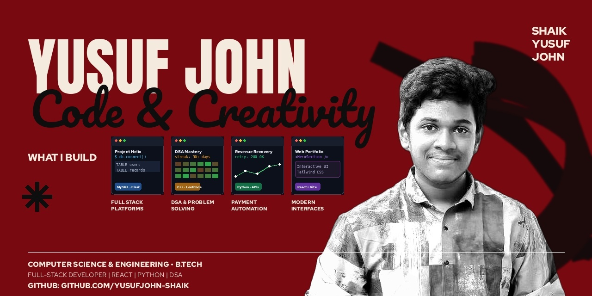

<div align="center">

<!-- Custom Designed Hero Banner -->


<!-- Dynamic Typing Subtitle -->
<p align="center">
  
</p>

<!-- Live Status & Quick Identity Badges -->
<p align="center">
  
  
  
</p>

<!-- Connected Channels & Badges -->
<p align="center">
  <a href="https://leetcode.com/u/shaikyusufjohn/" target="_blank">
    
  </a>
  <a href="https://github.com/yusufjohn-shaik">
    
  </a>
  <a href="mailto:yusufjohn252007@gmail.com">
    
  </a>
  <a href="https://github.com/yusufjohn-shaik">
    
  </a>
</p>

</div>

---

### ⚡ About Me

<table>
  <tr>
    <td width="62%" valign="top">
      <h3>Hey, I'm Shaik Yusuf John 👋</h3>
      <p>
        Computer Science undergraduate &amp; Full-Stack Developer passionate about engineering clean, responsive digital products and solving challenging algorithmic problems.
      </p>
      <p>
        💻 <b>Frontend:</b> Building modern, responsive UIs with <b>React.js</b>, <b>Tailwind CSS</b>, and <b>Vite</b>.<br/>
        ⚙️ <b>Backend:</b> Architecting RESTful APIs and database persistence with <b>Python</b>, <b>Flask</b>, and <b>MySQL</b>.<br/>
        🧠 <b>DSA:</b> <b>100+ Day Active Streak</b> on LeetCode mastering optimal patterns in <b>C++</b> &amp; <b>Python</b>.<br/>
        🚀 <b>Currently:</b> Building full-stack web platforms, exploring system design, and shipping open-source software.
      </p>
      <p>
        <i>"Turning complex algorithmic logic into intuitive user experiences."</i>
      </p>
    </td>
    <td width="38%" align="center" valign="middle">
      
    </td>
  </tr>
</table>

---

### 🛠️ Tech Stack &amp; Arsenal

<div align="center">

<p align="center">
  <b>Languages &amp; Core Systems</b><br/>
  <a href="https://skillicons.dev">
    
  </a>
</p>

<p align="center">
  <b>Frontend &amp; User Interfaces</b><br/>
  <a href="https://skillicons.dev">
    
  </a>
</p>

<p align="center">
  <b>Backend &amp; Databases</b><br/>
  <a href="https://skillicons.dev">
    
  </a>
</p>

<p align="center">
  <b>DevOps, Environment &amp; Tools</b><br/>
  <a href="https://skillicons.dev">
    
  </a>
</p>

</div>

---

### 💻 Developer Terminal

```bash
┌──(yusuf㉿cyber-system)-[~]
└─$ curl -s https://api.yusufjohn.dev/profile | jq .
{
  "developer": "Shaik Yusuf John",
  "role": "Frontend & Full-Stack Engineer",
  "streak": "100+ Consecutive Days on LeetCode",
  "status": "Available for high-impact projects & collaboration",
  "interests": ["Scalable Web Architecture", "System Design", "Algorithmic Efficiency"]
}
```

---

### 🚀 Featured Projects

<div align="center">

<p align="center">
  <a href="https://github.com/yusufjohn-shaik/project-Helix">
    
  </a>
  <a href="https://github.com/yusufjohn-shaik/dsa-prep">
    
  </a>
</p>

<p align="center">
  <a href="https://github.com/yusufjohn-shaik/razorpay-revenue-recovery">
    
  </a>
  <a href="https://github.com/yusufjohn-shaik/portfolio">
    
  </a>
</p>

</div>

---

### 📊 GitHub &amp; LeetCode Analytics

<div align="center">

<!-- GitHub Stats & Streak Cards -->
<p align="center">
  
  
  
</p>

<!-- LeetCode Heatmap Card -->
<p align="center">
  <a href="https://leetcode.com/u/shaikyusufjohn/" target="_blank">
    
  </a>
</p>

</div>

---

### 🪴 Cyber Bonsai Garden &amp; Digital Pets

<div align="center">
  
</div>

---

<div align="center">

<h3 align="center">
<i>"Consistency compounds harder than talent."</i> ⚡
</h3>

<!-- Footer Banner -->


</div>
