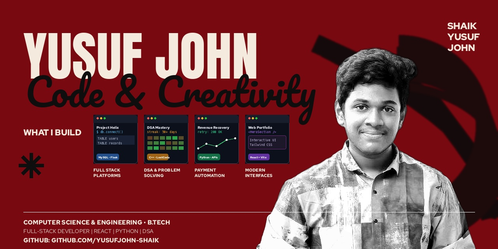

<!-- Custom Designed Hero Banner -->

<!-- Dynamic Typing Subtitle -->

  

<!-- Connected Badges -->

  
  
  
  

---

### ⚡ About Me

<table>
  <tr>
    <td width="62%" valign="top">
      <h3>Hey, I'm Shaik Yusuf John 👋</h3>
      

        Computer Science undergraduate and Full-Stack Developer passionate about engineering clean, responsive digital products and solving challenging algorithmic problems.
      

      

        💻 <b>Frontend:</b> Building modern, responsive UIs with <b>React.js</b>, <b>Tailwind CSS</b>. 
        ⚙️ <b>Backend:</b> Developing RESTful APIs and database persistence with <b>Python</b>, <b>Flask</b>, and <b>MySQL</b>. 
        🧠 <b>DSA:</b> <b>100+ Day Streak</b> on LeetCode practicing optimal patterns in <b>C++</b> & <b>Python</b>. 
        🚀 <b>Currently:</b> Building full-stack web platforms and open-source projects.
      

    </td>
    <td width="38%" align="center" valign="middle">
      
    </td>
  </tr>
</table>

---

### 🛠️ Tech Stack & Arsenal

  

    
  

---

### 🚀 Featured Projects

  
  

  
  

---

### 📊 GitHub & LeetCode Analytics

<!-- GitHub Stats & Streak Cards -->

  
  

<!-- LeetCode Heatmap Card -->

  

---

### 🐍 Contribution Activity

  

---

<h3 align="center">
<i>"Consistency compounds harder than talent."</i> ⚡
</h3>

<!-- Footer Banner -->

